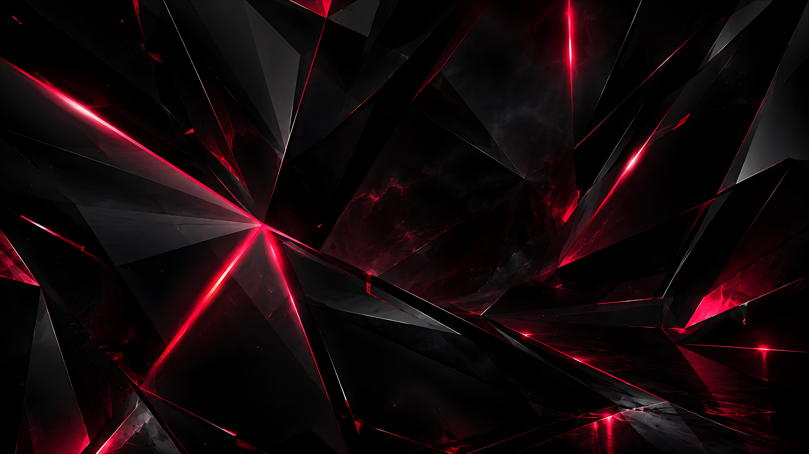
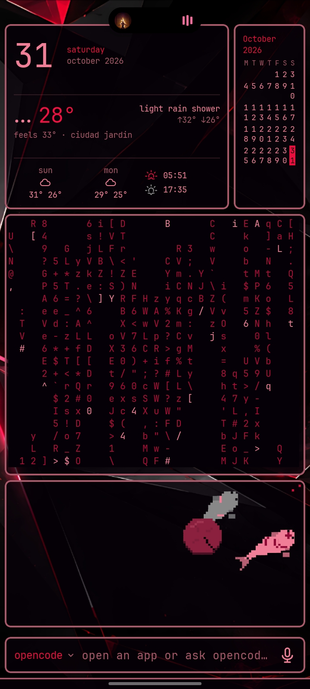
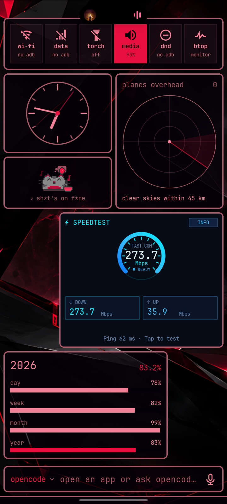
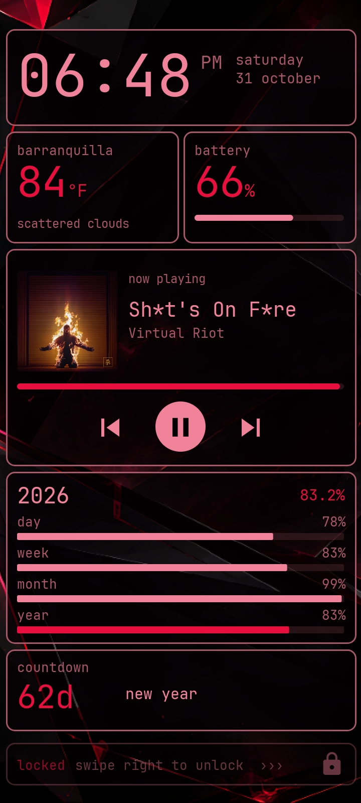
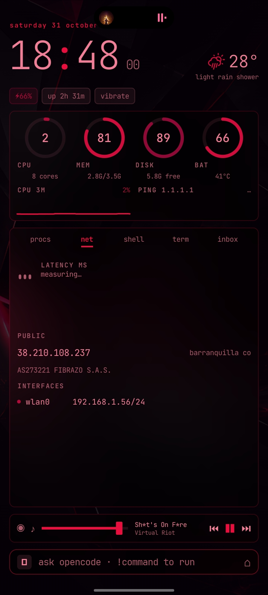
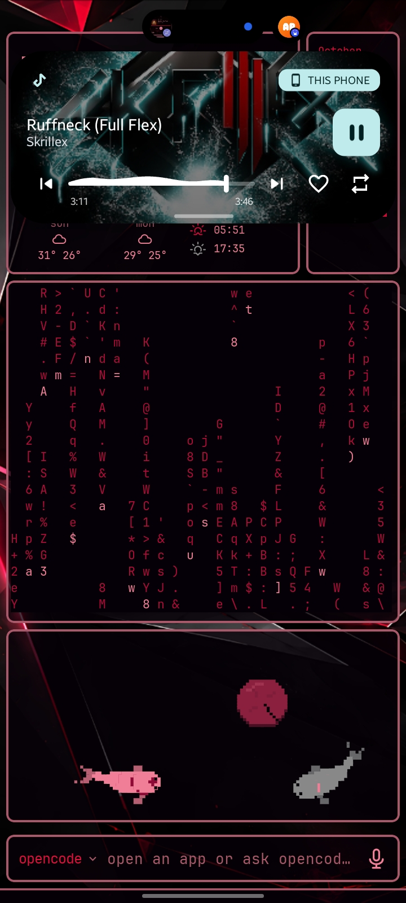
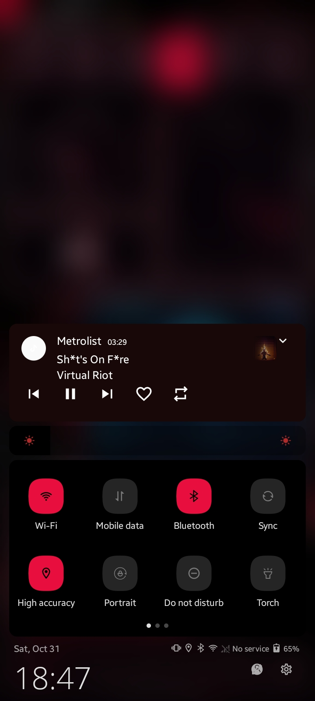
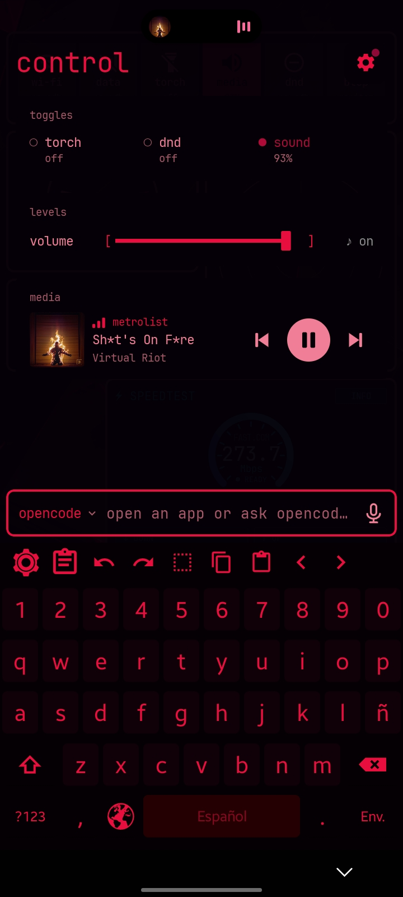

# 🩸 pink-blood

Mi setup personalizado de Android para el día a día. Hecho en un **Samsung A03M**, todo sin root.



## 📸 Vista previa

<table>
  <tr>
    <td align="center"><br><sub>Página 1</sub></td>
    <td align="center"><br><sub>Página 2</sub></td>
    <td align="center"><br><sub>Página 3</sub></td>
  </tr>
  <tr>
    <td align="center"><br><sub>Pantalla de bloqueo</sub></td>
    <td align="center"><br><sub>Face</sub></td>
    <td align="center"><br><sub>Smart Island</sub></td>
  </tr>
  <tr>
    <td align="center"><br><sub>Panel de MIUI-ify</sub></td>
    <td align="center"><br><sub>Notificaciones</sub></td>
    <td></td>
  </tr>
</table>

## 📋 Tabla de contenidos

- [Vista previa](#-vista-previa)
- [Apps necesarias](#-apps-necesarias)
- [Configuración de Omalauncher](#-configuración-de-omalauncher)
- [Configuración de MIUI-ify](#️-configuración-de-miui-ify)
- [Eliminar los ajustes rápidos nativos](#-eliminar-los-ajustes-rápidos-nativos)
- [Configuración de Smart Island](#️-configuración-de-smart-island)
- [Configuración de HeliBoard](#️-configuración-de-heliboard)
- [Configuración de KLCK](#-configuración-de-klck)
- [Scripts](#️scripts)
- [Extras](#extras)

---

## 📦 Apps necesarias

- Shizuku
- Cebian
- Smart Island
- Omalauncher
- Test DPC
- KLCK
- HeliBoard
- MIUI-ify
- Un launcher local de ADB como LADB (o una PC si tienes una)

---

## 🚀 Configuración de Omalauncher

Instala Omalauncher y ponlo como pantalla de inicio predeterminada en **Ajustes**. Luego personalízalo:

1. Busca y selecciona el tema **"pink blood"**.
2. Aplica los siguientes ajustes de estilo.

**Pantalla de inicio**

| Opción | Valor |
|---|---|
| Iconos | Monocromo |
| Apps de inicio | Solo iconos |
| Apps recientes | Ocultas |
| Columnas | 4 |
| Páginas | Una |
| Esquinas | Suaves |

**Widgets**

| Opción | Valor |
|---|---|
| Espacio interior | 6dp |
| Espacio exterior | 6dp |
| Ancho del borde | 2dp |
| Opacidad | 0.74 |
| Vidrio esmerilado | Desactivado |

**Pantallas**

| Opción | Valor |
|---|---|
| Espacio exterior | 6dp |
| Ancho del borde | 2dp |

**Barra de teclas de la terminal**

| Opción | Valor |
|---|---|
| Espacio exterior | 6dp |
| Ancho del borde | 2dp |

**Barras del sistema**

| Opción | Valor |
|---|---|
| Barra de estado | Oculta |
| Fondo | Visible |
| Ancho del borde | 2dp |

**Launcher y widgets**

| Opción | Valor |
|---|---|
| Fuente | JetBrains Mono NL |
| Texto | Medium |

3. Usa el wallpaper incluido en este repo como imagen de fondo.
4. Ve a **Ajustes (Omalauncher) → Linux** y descarga Linux.
5. Ve a **Ajustes (Omalauncher) → Coding agents** y descarga OpenCode (u otro agente de código).

Con esto termina la configuración de Omalauncher.

---

## 🎛️ Configuración de MIUI-ify

Ahora configura MIUI-ify junto con Cebian.

> **Nota:** las opciones que no aparecen listadas abajo están **desactivadas**.

**Handles (manijas)**

- Ocultar en modo horizontal
- Ocultar mientras el teclado está abierto

**Notificaciones**

- Mostrar notificaciones
- Mostrar solo notificaciones de música
- Quitar el espacio entre notificaciones
- Expandir notificaciones automáticamente

**Tipo de fondo**

- Fondo difuminado

**Sliders**

- Brillo

**Estilo de los tiles**

| Opción | Valor |
|---|---|
| Forma del icono del tile | Squircle |
| Fondo del tile (activado) | `FFE80E3E` |
| Fondo del tile (desactivado) | `7A4D4D4D` 54% |
| Icono del tile (activado) | `FF000000` |
| Icono del tile (desactivado) | `FF797979` |

**Layout**

| Opción | Valor |
|---|---|
| Número de filas | 2 |
| Número de columnas | 4 |
| Número de columnas pequeñas | 6 |
| Radio de las esquinas del panel | 10 |
| Padding del panel | 12 |
| Tamaño del tile | 46 |

Activa también:

- Mostrar el pie del panel
- Recortar los iconos de apps en círculo
- Usar reloj de 24 horas

**Extras**

- Vibrar al tocar
- Vibrar usando la vibración háptica del dispositivo
- Brillo suave
- Mostrar el SSID de la red Wi-Fi

### Configuración de gestos (Cebian)

> **Nota:** las opciones que no aparecen listadas están desactivadas o en *ninguna*. "Active" significa que la opción está activada pero sin ninguna acción asignada.

- **Animación del gesto:** wave
- **Pantalla de bloqueo:** activada
- **Pantalla de inicio:** activada
- **Handle sets → Left handles:** active
- **Handle sets → Right handles:** active
- **Handle sets → Bottom handle → Double tap → Action type → Shortcuts → My shortcuts**

En ese último menú, busca y selecciona **MIUI-ify**, y luego elige la opción **"Open panel"**.

---

## 🧹 Eliminar los ajustes rápidos nativos

Ahora mismo tienes dos menús de ajustes rápidos: el de MIUI-ify y el nativo de Android. Para quedarte solo con el de MIUI-ify, elimina el nativo.

1. En tu launcher local de ADB (o desde una PC), ejecuta:

   ```bash
   dpm set-device-owner com.afwsamples.testdpc/.DeviceAdminReceiver
   ```

   > ⚠️ **Si no funciona**, es porque tienes cuentas iniciadas. Ve a **Ajustes → Cuentas** y elimina todas las cuentas. Es una medida de seguridad de Google y es necesaria para desactivar los ajustes rápidos nativos.

2. Abre **Test DPC**. La forma más fácil es por ADB:

   ```bash
   am start -n com.afwsamples.testdpc/.PolicyManagementActivity
   ```

   También puedes abrirlo de cualquier otra forma.

3. Busca la opción **"Disable status bar"** y tócala **solo una vez**.

Ahora ya no se puede abrir el menú de ajustes rápidos nativo.

---

## 🏝️ Configuración de Smart Island

**Home**

- Activa todas las opciones

**Layout**

- Mostrar en modo horizontal
- Velocidad de animación (horizontal): **relaxed**
- Estilo de fusión con el notch: **slide**

**Ajustes**

- Fuente de la isla: **monospace**
- Atajos: **no shortcuts**

---

## ⌨️ Configuración de HeliBoard

Primero, pon HeliBoard como teclado predeterminado en **Ajustes** y luego configúralo así.

**Preferencias**

- Fila de números
- Tecla de cambio de idioma
- Tecla D-pad
- Eliminar popups redundantes
- Activar historial del portapapeles
- Tiempo de retención del portapapeles: **sin límite**
- Mostrar elemento fijado arriba
- Agregar imágenes y otros archivos al historial del portapapeles

**Estilo**

- Estilo: **Material**
- Estilo de iconos: **Holo**
- Bordes de teclas: activado
- Colores → **+** → *Definido por el usuario*

Colores para el tema de color personalizado:

| Elemento | Color |
|---|---|
| Fondo del teclado | `#050004` |
| Fondo de las teclas | `#100108` |
| Fondo de las teclas funcionales | `#050004` |
| Fondo de la barra espaciadora | `#240002` |
| Texto de las teclas | `#E80E3E` |
| Texto de ayuda de las teclas | `#E80E3E` |
| Acento | `#050004` |

**Barra de herramientas**

- Ocultar el teclado deslizando
- Dirección variable de la barra de herramientas

**Corrección de texto**

- Todo desactivado

**Avanzado**

- Deslizar para borrar
- Cambiar de método de entrada con la barra espaciadora
- Emoji para teclado físico
- Volver al teclado principal después de...

---

## 🔒 Configuración de KLCK

KLCK es la app que cambia la pantalla de bloqueo. En KLCK, importa el archivo `.klck` incluido en este repo.

## 🖥️ Scripts

Ahora la única forma de abrir apps es desde la terminal. Para esto necesitas crear los archivos `app-poll.owl` y `app` con los siguientes comandos en una terminal de Omalauncher (con Linux instalado):

```bash
nano /usr/local/bin/app
```

```bash
nano /root/.config/omalauncher/widgets/app-poll.owl
```

y pega el contenido que tienen esos mismos archivos en este repo.

## 📋 Extras

La fuente del sistema es **JetBrains Mono NL Medium**. En Samsung necesitas descargar e instalar `#mono_` y seguir los pasos que muestra la app.
