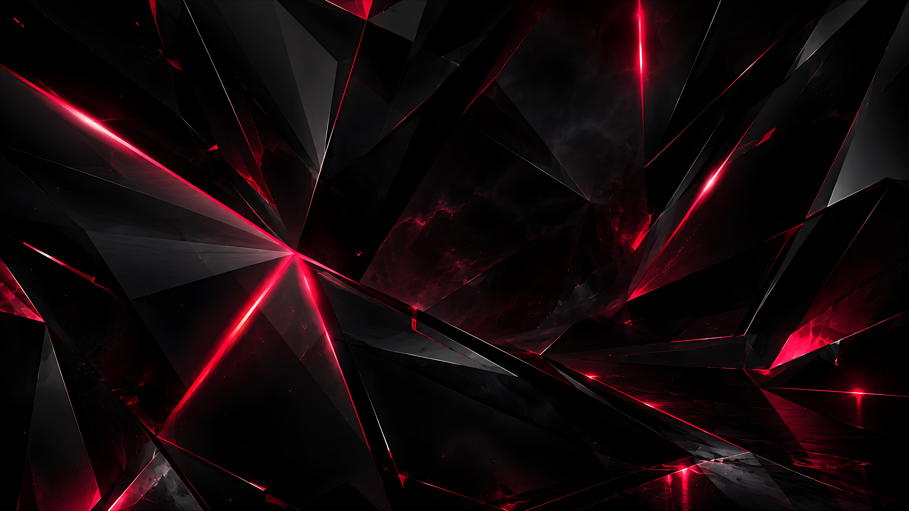
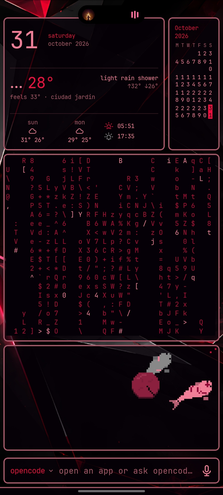
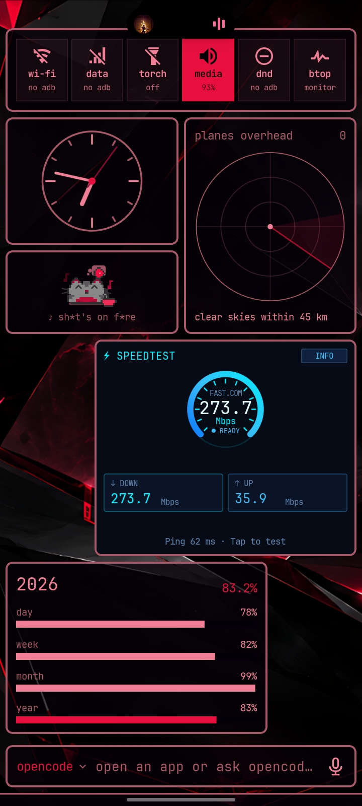
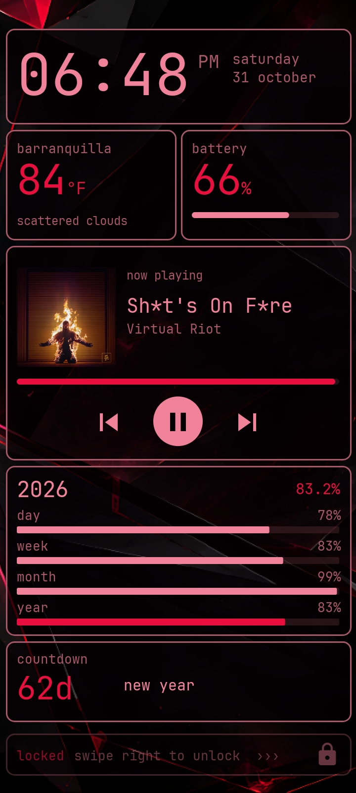
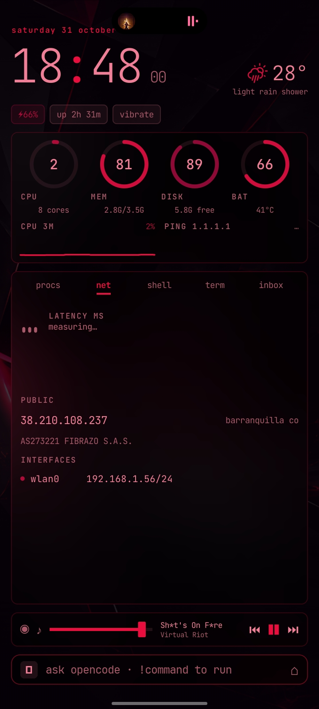
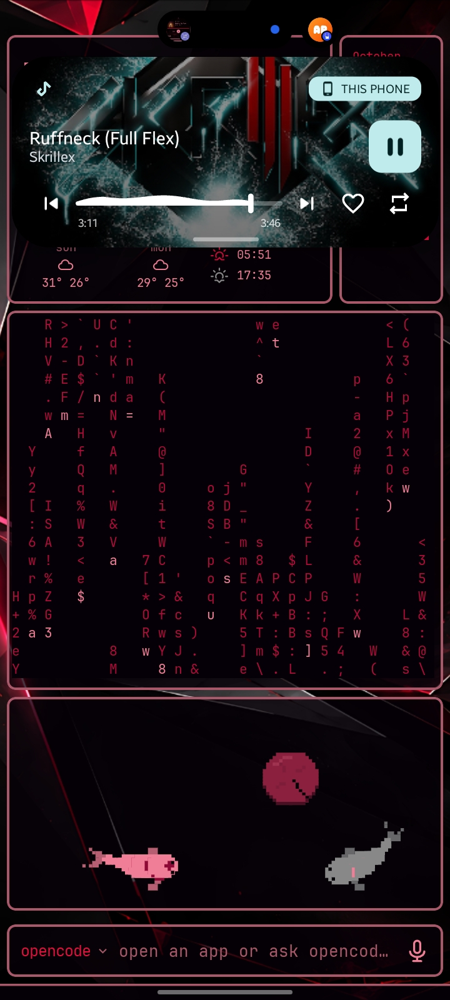
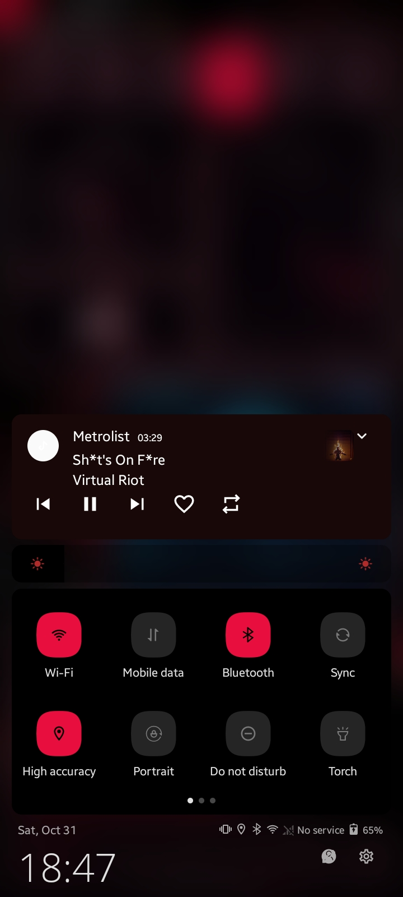
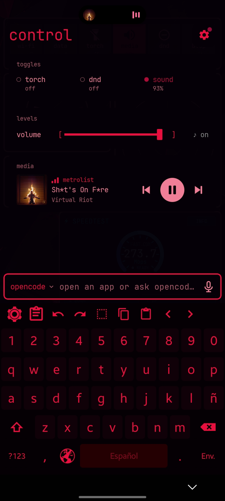

# 🩸 pink-blood

My custom Android setup for everyday tasks. Built on a **Samsung A03M**.



## 📸 Preview

<table>
  <tr>
    <td align="center"><br><sub>Page 1</sub></td>
    <td align="center"><br><sub>Page 2</sub></td>
    <td align="center"><br><sub>Page 3</sub></td>
  </tr>
  <tr>
    <td align="center"><br><sub>Lock screen</sub></td>
    <td align="center"><br><sub>Face</sub></td>
    <td align="center"><br><sub>Smart Island</sub></td>
  </tr>
  <tr>
    <td align="center"><br><sub>MIUI-ify panel</sub></td>
    <td align="center"><br><sub>Notifications</sub></td>
    <td></td>
  </tr>
</table>

## 📋 Table of contents

- [Preview](#-preview)
- [Required apps](#-required-apps)
- [Omalauncher setup](#-omalauncher-setup)
- [MIUI-ify setup](#-miui-ify-setup)
- [Removing the native quick settings](#-removing-the-native-quick-settings)
- [Smart Island setup](#-smart-island-setup)
- [HeliBoard setup](#-heliboard-setup)
- [KLCK setup](#-klck-setup)

---

## 📦 Required apps

- Shizuku
- Cebian
- Smart Island
- Omalauncher
- Test DPC
- KLCK
- HeliBoard
- MIUI-ify
- A local ADB launcher (or a PC if you have one)

---

## 🚀 Omalauncher setup

Install Omalauncher and set it as your default home screen in **Settings**. Then customize it:

1. Search for and select the theme **"pink blood"**.
2. Apply the following style settings.

**Home screen**

| Option | Value |
|---|---|
| Icons | Monochrome |
| Home apps | Icons only |
| Recent apps | Hidden |
| Columns | 4 |
| Pages | One |
| Corners | Soft |

**Widgets**

| Option | Value |
|---|---|
| Gaps in | 6dp |
| Gaps out | 6dp |
| Border width | 2dp |
| Opacity | 0.74 |
| Frosted glass | Off |

**Screens**

| Option | Value |
|---|---|
| Gaps out | 6dp |
| Border width | 2dp |

**Terminal keybar**

| Option | Value |
|---|---|
| Gaps out | 6dp |
| Border width | 2dp |

**System bars**

| Option | Value |
|---|---|
| Status bar | Hidden |
| Background | Shown |
| Border width | 2dp |

**Launcher and widgets**

| Option | Value |
|---|---|
| Font | JetBrains Mono NL |
| Text | Medium |

3. Use the wallpaper included in this repo as the background image.
4. Go to **Settings (Omalauncher) → Linux** and download Linux.
5. Go to **Settings (Omalauncher) → Coding agents** and download OpenCode (or another code agent).

That completes the Omalauncher setup.

---

## 🎛️ MIUI-ify setup

Next, configure MIUI-ify together with Cebian.

> **Note:** options that are not listed below are **disabled**.

**Handles**

- Hide in landscape mode
- Hide while keyboard is open

**Notifications**

- Show notifications
- Only show music notifications
- Remove spacing between notifications
- Auto expand notifications

**Background type**

- Blur background

**Sliders**

- Brightness

**Tile style**

| Option | Value |
|---|---|
| Tile icon shape | Squircle |
| Tile background (enabled) | `FFE80E3E` |
| Tile background (disabled) | `7A4D4D4D` 54% |
| Tile icon (enabled) | `FF000000` |
| Tile icon (disabled) | `FF797979` |

**Layout**

| Option | Value |
|---|---|
| Number of rows | 2 |
| Number of columns | 4 |
| Number of small columns | 6 |
| Panel corner radius | 10 |
| Panel padding | 12 |
| Tile size | 46 |

Also enable:

- Show panel footer
- Crop app icons to circles
- Use 24 hour clock

**Extras**

- Vibrate on touch
- Vibrate using device haptic feedback
- Smooth brightness
- Show Wi-Fi network SSID

### Gesture configuration (Cebian)

> **Note:** options that are not listed are disabled or set to *none*. "Active" means the option is enabled but has no action assigned.

- **Gesture animation:** wave
- **Lock screen:** enabled
- **Home screen:** enabled
- **Handle sets → Left handles:** active
- **Handle sets → Right handles:** active
- **Handle sets → Bottom handle → Double tap → Action type → Shortcuts → My shortcuts**

In that last menu, search for and select **MIUI-ify**, then choose the option **"Open panel"**.

---

## 🧹 Removing the native quick settings

At this point you have two quick settings menus: MIUI-ify and the native Android one. To keep only the MIUI-ify menu, remove the native one.

1. In your local ADB launcher (or from a PC), run:

   ```bash
   dpm set-device-owner com.afwsamples.testdpc/.DeviceAdminReceiver
   ```

   > ⚠️ **If it doesn't work**, it's because you have accounts signed in. Go to **Settings → Accounts** and remove all signed-in accounts. This is a security measure enforced by Google and it's required to disable the native quick settings.

2. Open **Test DPC**. The easiest way is via ADB:

   ```bash
   am start -n com.afwsamples.testdpc/.PolicyManagementActivity
   ```

   You can also open it any other way you prefer.

3. Find the **"Disable status bar"** option and tap it **only once**.

Now the native quick settings menu can no longer be opened.

---

## 🏝️ Smart Island setup

**Home**

- Enable all options

**Layout**

- Show in landscape mode
- Animation speed (landscape): **relaxed**
- Cutout merge style: **slide**

**Settings**

- Island font: **monospace**
- Shortcuts: **no shortcuts**

---

## ⌨️ HeliBoard setup

First, set HeliBoard as your default keyboard in **Settings**, then configure it as follows.

**Preferences**

- Number row
- Language switch key
- D-pad key
- Remove redundant popups
- Enable clipboard history
- Clipboard retention time: **no limit**
- Show pinned item on top
- Add images and other files to clipboard history

**Style**

- Style: **Material**
- Icon style: **Holo**
- Key borders: enabled
- Colors → **+** → *User defined*

Colors for the custom color theme:

| Element | Color |
|---|---|
| Keyboard background | `#050004` |
| Key background | `#100108` |
| Functional key background | `#050004` |
| Space bar background | `#240002` |
| Key text | `#E80E3E` |
| Key hint text | `#E80E3E` |
| Accent | `#050004` |

**Toolbar**

- Hide keyboard by swipe
- Variable toolbar direction

**Text correction**

- All disabled

**Advanced**

- Delete swipe
- Change input method with space key
- Emoji for physical keyboard
- Switch to main keyboard after...

---

## 🔒 KLCK setup

KLCK is the app that changes the lock screen. In KLCK, import the `.klck` file included in this repo.

